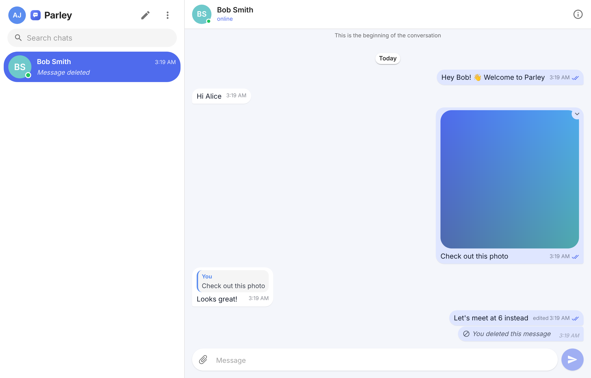
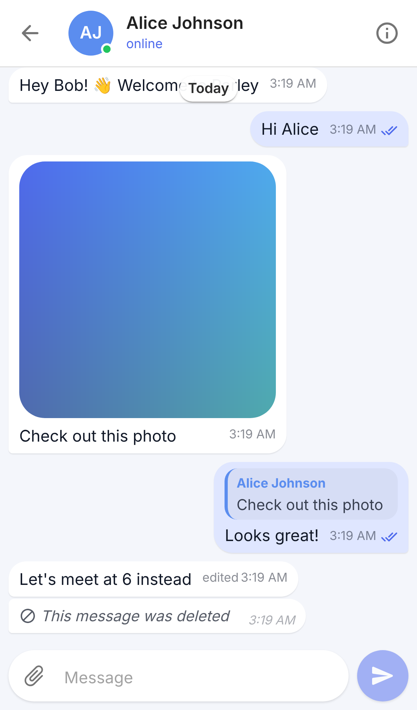
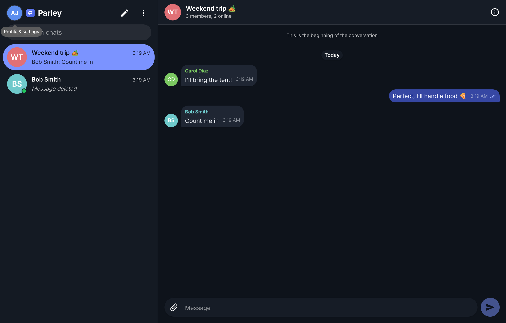

# Parley — real-time messenger

A Telegram/WhatsApp-style web messenger where people **sign up and sign in only with their phone number** (SMS one-time code) and chat in real time.

**Stack:** React 19 · Vite · TypeScript · Material UI 9 · Supabase (Postgres, Auth, Realtime, Storage)

| Desktop | Mobile | Dark mode |
| --- | --- | --- |
|  |  |  |

## Features

- **Phone-number-only accounts** — SMS one-time code, international country picker with validation (libphonenumber). No email, no passwords. Enforced in the database too: accounts without a phone number are rejected.
- **1:1 and group chats** — find people by their exact phone number, create groups, add/remove members, admins & owner roles, rename group, group photo, leave group (ownership is handed over automatically).
- **Live messaging** — new messages, edits and deletes appear instantly (Supabase Realtime).
- **Read receipts** — ✓ sent, ✓✓ read (blue), unread counters and an “Unread messages” divider.
- **Typing indicators** and **online / last seen** status.
- **Replies** (quote a message, click to jump to it), **edit** and **delete for everyone**.
- **Photos & files** up to 20 MB — attach, paste from clipboard or drag & drop. Stored in a private bucket.
- **Profiles** with name, photo and “about”.
- **Desktop notifications** and unread count in the tab title.
- **Responsive** — two-pane layout on desktop, WhatsApp-style list → chat navigation on phones.
- **Light / dark / system theme.**

## Security model

All authorization happens **inside Postgres**, so it holds no matter what a client sends:

| Layer | Protection |
| --- | --- |
| Auth | Supabase phone OTP. A `before insert` trigger on `auth.users` rejects any account without a phone number. |
| Row Level Security | Every table has RLS. You can only read conversations you are a member of, their messages and members, and profiles of people you share a chat with. Anonymous users can read nothing. |
| Writes | Clients cannot write to `conversations` / `conversation_members` at all; membership changes go through `SECURITY DEFINER` functions that check your role. Messages: only members can insert, `sender_id` is forced to the caller, only the sender can edit/delete, and only `body`/`deleted_at` are writable (column privileges + triggers). |
| Contact discovery | `find_user_by_phone` is exact-match only, hides unfinished profiles and is **rate limited** (30 lookups / 10 min) to stop number scraping. |
| Storage | Attachments live in a **private** bucket under `<conversation>/<uploader>/…`. Only members can read them (short-lived signed URLs); only the uploader can write/delete. Avatars can only be written to your own folder. |
| Realtime | Postgres-change events are filtered by the same RLS policies. Typing indicators use **private channels** (`conversation:<id>`) authorized by policies on `realtime.messages`. |

> **Note on encryption:** like Telegram’s regular (cloud) chats, messages are encrypted in transit (TLS) and at rest by Supabase, but are **not end-to-end encrypted** — the database operator can technically read them. End-to-end encryption would be a separate project (key management, multi-device).

The full schema is in [`supabase/migrations/20261125000000_parley_schema.sql`](supabase/migrations/20261125000000_parley_schema.sql), and [`tests/backend.test.mjs`](tests/backend.test.mjs) checks these rules against a real Supabase stack (16 tests, including outsiders trying to read, write, download and eavesdrop).

## Run it locally

Requirements: Node 20+, Docker (for the local Supabase stack).

```bash
npm install
npm run db:start              # starts Supabase locally and applies the migration
cp .env.example .env.local    # the defaults match the local stack
npm run dev                   # http://localhost:5173
```

Sign in with one of the **test numbers** (no SMS is sent): `+1 201 555 0100`, `0101`, `0102` or `0103`, code **`123456`**. Open a second browser (or a private window) with another number to chat with yourself.

## Deploy

### 1. Supabase project

1. Create a project at [supabase.com](https://supabase.com).
2. Apply the schema:
   ```bash
   npx supabase login
   npx supabase link --project-ref <your-project-ref>
   npx supabase db push
   ```
3. **Authentication → Sign In / Providers**
   - Enable **Phone** and configure an SMS provider (Twilio, Twilio Verify, MessageBird, Vonage or Textlocal). Real SMS delivery needs an account with one of these.
   - Disable **Email** (the database blocks non-phone sign-ups anyway).
   - Optional for testing: add test phone numbers with fixed codes.
4. **Authentication → URL Configuration**: set the Site URL to your deployed domain.

### 2. Frontend (Vercel, Netlify, any static host)

Build with `npm run build` and serve `dist/`. Set these environment variables (Supabase → Project Settings → API):

```
VITE_SUPABASE_URL=https://<project-ref>.supabase.co
VITE_SUPABASE_ANON_KEY=<publishable / anon key>
```

`vercel.json` already rewrites all routes to `index.html` for client-side routing.

## Scripts

| Command | What it does |
| --- | --- |
| `npm run dev` | Vite dev server |
| `npm run build` | Type-check + production build |
| `npm run lint` | oxlint |
| `npm run db:start` / `db:stop` / `db:reset` | Local Supabase stack |
| `npm run test:backend` | Security & behaviour tests against the local stack (wait a few seconds after `db:reset` so Realtime is ready) |
| `npm run gen:types` | Regenerate `src/lib/database.types.ts` from the local schema |

## Project structure

```
supabase/
  config.jsonc                 local stack config (phone auth, test numbers)
  migrations/                  schema, RLS, functions, storage & realtime policies
src/
  contexts/AuthContext.tsx     session + profile
  contexts/ChatContext.tsx     chat list + the single realtime subscription
  hooks/                       messages (pagination, optimistic send, uploads), members, typing, presence
  components/                  sidebar, dialogs, phone input, avatars, settings
  components/chat/             chat view, message list/bubbles, composer, attachments, info drawer
  pages/                       login, profile setup, messenger layout
tests/backend.test.mjs         backend security tests
```
